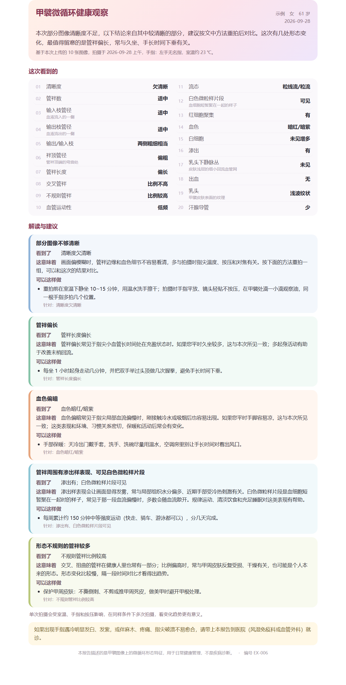

# 甲襞微循环图像分析


输入：同一次检查拍摄的若干张静态甲襞显微图像（jpg/png/bmp/tif）。

输出：
- 一份 20 项结构化观察（JSON）。
- 一页面向用户的健康观察卡（HTML）。卡片里有按识别结果组合的差异化生活建议。

本地运行即可，不依赖大模型，不需要联网。项目定位是日常健康管理图像观察；未提供临床有效性或医疗器械资质验证，不做疾病诊断。



上图是开发集一例的实际输出，姓名、年龄为示例值。其余 8 例的 JSON 见 [examples/reports/](examples/reports/)。

> 模型文件不在代码里，在 GitHub Release [expert-router-final](https://github.com/liu66-qing/nailfold-capillaroscopy/releases/tag/expert-router-final)。克隆后先按 [§1.0](#10-下载模型文件) 下载，否则无法运行。

---

## 交接清单

本仓库当前内容即最终交付版本。代码、模型和接口沿用现有结构；接入时从下表查找对应内容。`expert-router-final` 是模型附件的固定标识。目录按代码、模型、示例、输出定义和评估材料划分。

| 交接项 | 入口 | 用途 |
|---|---|---|
| 推理代码 | [final_inference.py](src/nailfold_report/final_inference.py) | `FinalReportPredictor`，一次检查多张图输入，输出结构化报告 |
| HTTP 接口 | [final_api.py](src/nailfold_report/final_api.py) | `POST /v1/reports`；运行方法见下方快速开始 |
| 建议和页面 | [final_advice.py](src/nailfold_report/final_advice.py)、[final_render.py](src/nailfold_report/final_render.py) | 建议规则及健康观察卡 |
| 模型下载 | [Release 附件](https://github.com/liu66-qing/nailfold-capillaroscopy/releases/tag/expert-router-final) | 5个必需文件，具体落盘路径见下方下载表 |
| 依赖 | [requirements.txt](requirements.txt) | 安装运行环境 |
| 输出定义 | [标签映射](schemas/label_mapping.json)、[字段注册表](src/nailfold_report/final_registry.py)、[JSON schema](schemas/report.schema.json)、[示例](examples/reports/) | 20项输出及取值；20个二分类目标组合出预测字段，另有固定项和派生项 |
| 模型校验 | [manifest.json](artifacts/models/expert_router_v1/manifest.json) | 核心权重SHA256，推理加载时自动检查 |
| 全量内部交叉验证 | [逐字段表](evaluation/README.md)、[完整指标](evaluation/metrics.json) | 有效n、ACC、BA、AUROC、召回、混淆矩阵及指标口径 |
| 47例评估子集 | [指标表](evaluation/subset_47/README.md)、[完整指标](evaluation/subset_47/metrics.json) | 内部交叉验证折外结果 |
| 47例原图与标签 | [下载数据包](https://github.com/liu66-qing/nailfold-capillaroscopy/releases/download/expert-router-final/subset47_public_v1.zip)、[校验信息](evaluation/subset_47/data_download.json) | 47例、402张原图、21字段；`labels.csv`按病例，`images.csv`关联图像 |
| 留一档案评估 | [router_loao.csv](artifacts/experiments/expert_routes_20260928/router_loao.csv) | 使用原始概率与训练阳性率的阈值；与发布端校准阈值不同 |

接入顺序：安装依赖 → 下载5个模型文件 → 调用Python或启动HTTP服务 → 用47例包核对输入和标签 → 用同事持有的数据开展独立测试。已有47例指标按上表所列内部验证口径使用。

---

## 上传材料记录

| 提交 | 上传或修改的材料 |
|---|---|
| `948be83` | 新增交付证据表 `evidence/README.md`、完整指标 `evidence/metrics.json`、复算脚本 `scripts/build_delivery_evidence.py`；首页增加入口 |
| `c52db4f` | 新增47例子集指标表、完整指标JSON、复算脚本 `scripts/build_subset47_evidence.py` |
| `2c4ee7e` | 新增47例原图与标签包下载信息 `data_download.json`、打包脚本 `scripts/package_subset47_public.py`；Release附件上传 `subset47_public_v1.zip`（47例、402张原图、21字段标签、图像索引和校验值） |
| `31ab3df` | 更新首页交接清单，统一列出代码、权重、运行方式、评估指标及数据下载入口 |
| `66314f2` | 新增上传材料记录；更新Release附件的逐项说明 |
| `eb8ebe9` | 依赖归根目录，Schema归schemas，示例归examples/reports，指标归evaluation，校验清单归模型目录；同步迁移接口、测试及生成脚本的路径 |

目录迁移后的材料位置见下方目录对照；运行代码、脚本及测试均使用新路径。


## 1. 快速开始

先克隆本仓库`main`并在仓库根目录运行命令。使用独立Python环境；固定版本以 `requirements.txt` 为准。`pyproject.toml` 的基础依赖不覆盖完整推理环境，单独 `pip install -e .` 不足以运行。

```bash
pip install -r requirements.txt
pip install -e .
```

scikit-learn 必须是 1.9.0，因为分类头是 pickle 的 sklearn 管线，换版本加载会失败或结果漂移。

### 1.0 下载模型文件

5 个文件共约 420 MB，放在 Release [expert-router-final](https://github.com/liu66-qing/nailfold-capillaroscopy/releases/tag/expert-router-final)。其中 DINOv2 权重超过 git 单文件 100 MB 的上限，所以不进仓库。按下表放到仓库内对应路径，点击文件名可以直接下载：

| 文件 | 放到 | 大小 |
|---|---|---|
| [bundle.joblib](https://github.com/liu66-qing/nailfold-capillaroscopy/releases/download/expert-router-final/bundle.joblib) | `artifacts/models/expert_router_v1/bundle.joblib` | 19.8 MB |
| [seg_s0.pt](https://github.com/liu66-qing/nailfold-capillaroscopy/releases/download/expert-router-final/seg_s0.pt) | `artifacts/models/expert_router_v1/seg_s0.pt` | 43.1 MB |
| [det_capillary.pt](https://github.com/liu66-qing/nailfold-capillaroscopy/releases/download/expert-router-final/det_capillary.pt) | `artifacts/models/expert_router_v1/det_capillary.pt` | 18.3 MB |
| [dinov2_b_model.safetensors](https://github.com/liu66-qing/nailfold-capillaroscopy/releases/download/expert-router-final/dinov2_b_model.safetensors) | `weights/dinov2/b/model.safetensors` | 330 MB |
| [rag_heads_v1_bundle.joblib](https://github.com/liu66-qing/nailfold-capillaroscopy/releases/download/expert-router-final/rag_heads_v1_bundle.joblib) | `artifacts/models/rag_heads_v1/bundle.joblib` | 7.4 MB |

下面是Bash命令（Git Bash / Linux / macOS）；Windows PowerShell请使用本节后附命令。也可以在仓库根目录用命令一次下好，文件会直接落到上表的路径：

```bash
B=https://github.com/liu66-qing/nailfold-capillaroscopy/releases/download/expert-router-final
curl -fL --create-dirs -o artifacts/models/expert_router_v1/bundle.joblib    $B/bundle.joblib
curl -fL --create-dirs -o artifacts/models/expert_router_v1/seg_s0.pt        $B/seg_s0.pt
curl -fL --create-dirs -o artifacts/models/expert_router_v1/det_capillary.pt $B/det_capillary.pt
curl -fL --create-dirs -o weights/dinov2/b/model.safetensors                 $B/dinov2_b_model.safetensors
curl -fL --create-dirs -o artifacts/models/rag_heads_v1/bundle.joblib        $B/rag_heads_v1_bundle.joblib
```

Windows PowerShell（根目录运行）：

```powershell
$baseUrl = 'https://github.com/liu66-qing/nailfold-capillaroscopy/releases/download/expert-router-final'
$files = @{
  'bundle.joblib' = 'artifacts/models/expert_router_v1/bundle.joblib'
  'seg_s0.pt' = 'artifacts/models/expert_router_v1/seg_s0.pt'
  'det_capillary.pt' = 'artifacts/models/expert_router_v1/det_capillary.pt'
  'dinov2_b_model.safetensors' = 'weights/dinov2/b/model.safetensors'
  'rag_heads_v1_bundle.joblib' = 'artifacts/models/rag_heads_v1/bundle.joblib'
}
foreach ($name in $files.Keys) {
  New-Item -ItemType Directory -Force -Path (Split-Path $files[$name]) | Out-Null
  Invoke-WebRequest -Uri "$baseUrl/$name" -OutFile $files[$name]
}
python scripts/verify_handoff.py --check-models
```

说明：
- 加载时会逐个校验 sha256，不匹配就报 `AssetMismatch`，所以不需要手动校验。四个核心权重在加载时校验；配置包也有独立哈希。五个附件可统一用 `python scripts/verify_handoff.py --check-models` 核验，清单见 [manifest.json](artifacts/models/expert_router_v1/manifest.json)。
- `rag_heads_v1/bundle.joblib` 里只读取编码器结构和预处理配置。DINOv2 由 `timm` 离线加载，不联网，也不需要 config 文件。

### 1.1 Python 调用

```python
from pathlib import Path
from nailfold_report.final_inference import FinalReportPredictor
from nailfold_report.final_render import render_html, thumbnail_bytes

ROOT = Path(r"E:\甲劈微循环")            # 仓库根目录
p = FinalReportPredictor(ROOT, device="cpu")   # 或 "cuda:0"
paths = sorted(Path("某次检查").glob("*.jpg"))
report = p.predict(paths, exam_id="E001", device_id="unknown")   # dict，结构见 §3
render_html(report, "report.html",
            patient={"name": "张三", "sex": "女", "age": "52", "exam_date": "2026-09-28",
                     "capture_time": "上午", "finger": "左手无名指", "room_temp": "23"},
            images=thumbnail_bytes(paths))
```

在 CPU 上每张图约需 5~10 秒。一次检查通常有 8~10 张图，约 1 分钟；GPU 上是秒级。

### 1.2 HTTP 服务

```bash
uvicorn nailfold_report.final_api:app --host 127.0.0.1 --port 8000
```

> ⚠️ 接口没有任何鉴权，也没有限流。只能绑定 127.0.0.1，或放在平台网关后面，由网关负责认证。不要直接暴露到公网。

| 方法 | 路径 | 说明 |
|---|---|---|
| GET | `/` | 本地测试上传页 |
| GET | `/v1/health` | 返回 release_id 和 4 个模型文件的 sha256，可用于探活和版本核对 |
| POST | `/v1/reports` | multipart 表单，默认返回 JSON；加 `?format=html` 返回健康观察卡 HTML |
| GET | `/examples/{n}` | 示例报告 HTML，n = 1..8，需先运行 `scripts/make_final_examples.py` 生成 |

`POST /v1/reports` 的表单字段：

| 字段 | 必填 | 说明 |
|---|---|---|
| `exam_id` | 是 | 1~128 字符，原样写回报告 |
| `device_id` | 否 | 默认 `unknown` |
| `finger` | 否 | 左手无名指 / 右手无名指 / 左手中指 / 右手中指 / 其他，只用于 HTML 抬头 |
| `room_temp` | 否 | 0~45 的整数（℃），只用于 HTML 抬头 |
| `images` | 是 | 1~64 张，单张 ≤ 20 MB，扩展名 jpg/jpeg/png/bmp/tif/tiff |

错误码：
- 422：张数不对，或图像无法解码。
- 415：扩展名不支持。
- 413：单张超过 20 MB。

服务端不信任客户端文件名，图像只写到临时目录，请求结束即删除。

```bash
curl -F exam_id=E001 -F images=@1.jpg -F images=@2.jpg http://127.0.0.1:8000/v1/reports
```

环境变量：
- `NAILFOLD_ROOT`：仓库根目录，默认按包位置推断。
- `NAILFOLD_DEVICE`：`cpu` 或 `cuda:0`，默认 cpu。

---

## 2. 模型怎么工作

```
图像 ──┬─ A0  DINOv2-B 图像特征（5 种池化 → PCA64）
       ├─ COL 颜色 / 清晰度 / 背景统计（6 个区域）
       ├─ SEG S0 YOLO 分割器 → 每根管袢的几何与拓扑
       └─ DET Capillary-Dataset 检测器 → bushy/crossing/hairpin/tortuous 计数与比例
                 │ 每路按病例取均值
                 ▼
   20 个二分类目标 × 4 路专家（A0含5种池化头）（C=0.03）
                 │ 四个概率取平均 p
                 ▼
   Platt 校准 q = σ(a·logit p + b)，判定 q > 0.5
                 ▼
   20 行观察（二分类 / 三档 / 乳头 / 固定 / 派生） → 模板建议 → JSON / HTML
```

- 同一套路由用于所有字段，没有逐字段挑模型。逐字段挑选在实验里是负收益（固定配置在全部字段上都不差于折内逐字段挑选）。
- 三档行（输入枝、输出枝、袢顶管径、管袢长度）由"偏低"和"偏高"两个单侧头组合：P(适中) = max(0, 1 − P(低) − P(高))，三项归一化后取 argmax。
- 乳头由"平坦""波纹状"两个头组合，得到平坦 / 浅波纹状 / 波纹状三档。
- 4 行固定输出：血管运动性、白细胞、出血、汗腺导管。这些行不看图，直接输出注册表中的固定措辞；不能把固定措辞当作本病例的图像发现。
- 1 行派生：输出/输入枝，由两枝的档位组合出措辞，不做除法。
- 输出不含任何尺寸、计数、频次、积分或严重度分级。

### 各组件在什么数据上训练

| 组件 | 结构 | 训练数据 | 规模 | 许可 | 脚本 / 记录 |
|---|---|---|---|---|---|
| A0 图像特征 | DINOv2 ViT-B/14，权重冻结不训练 | Meta 官方预训练权重（LVD-142M 自然图像）；本项目只做 5 种池化 + PCA64 | — | Apache-2.0 | `src/nailfold_report/rag_inference.py` |
| COL 颜色/清晰度 | 手工统计量，无可训练参数 | 不需要训练 | — | — | `scripts/extract_color_quality_all233.py`、`extract_roi_quality_background_features.py` |
| SEG 分割器 S0 | YOLO11m-seg，imgsz 1024，40 epoch，seed 20260927 | ① 自家血管数据集：医生用 LabelMe 勾画的单根血管多边形，2332 张裁图，按原尺度拼到 1024 画布上；与 47例评估子集病例重叠的已剔除 ② ANFC-THU 的 Roboflow coco 导出版，train 257 张（6 类合并为 vessel） | 训练：裁图中文件号 %10≠0 的部分 + ANFC 257 张；验证：文件号 %10=0 的裁图 + ANFC valid | 自家数据；ANFC Roboflow 导出页标注 CC BY 4.0 | `scripts/mendeley_seg_build_base.py`、`mendeley_seg_train.py`；训练集清单在 `artifacts/derived/vascular_dataset_governance_20260830/train_ready/` |
| DET 形态检测器 | YOLO11s，imgsz 640，30 epoch，seed 20260917 | 公开数据集 [HanaNguyen/Capillary-Dataset](https://huggingface.co/datasets/HanaNguyen/Capillary-Dataset) 的 Morphology_detection 人工框，4 类 bushy / crossing / hairpin / tortuous | 1298 张图、7206 个框、103 人；按人分组留出 18 人 198 张做验证，mAP50 0.768 | Apache-2.0 | `scripts/train_morph_detector_folds.py`；[per_class.json](artifacts/experiments/rescue_external_20260922/detectors/external_pretrain/per_class.json) |
| 20 个二分类目标 + 校准 | 每路一个 LogisticRegression（C=0.03）+ Platt 校准 | 自家 233 例有医生报告的检查（3 个数据档案，2110 张图），标签是医生报告单上手填的各项结果 | 每个目标 n = 201~231 | 自家数据 | `scripts/fit_expert_router_final.py`；[metadata.json](artifacts/models/expert_router_v1/metadata.json) |

说明：
- SEG 和 DET 只负责产出几何、计数这类中间特征，它们自己的类别（vessel、bushy 等）不是报告字段。报告字段全部由最后一层分类头在自家标签上学出来。
- 训练 SEG / DET 时没有用到任何病例的报告标签，也没有用到 47例评估子集病例的图像。
- 目录名里的 `mendeley_` 是历史命名。最终 S0 没有使用 Mendeley 数据集（该数据集图像全部带设备叠加标记，不适合做外观训练）。

### 建议是怎么生成的（模板检索，非 LLM）

代码在 `src/nailfold_report/final_advice.py`。

1. 偏离行按含义归入 5 个主题：
   - 拍摄（清晰度）
   - 末梢偏凉（管径偏细、血色暗、管袢少）
   - 回流偏慢（管径偏粗、管袢偏长）
   - 形态（交叉、畸形、管袢偏短）
   - 局部环境（渗出、白色微粒样片段）

   没有偏离时输出"保持"主题。
2. 一行只有同时满足两个条件才触发建议：结果偏离常见答案，且校准概率离 0.5 足够远（等级 ≥ 中等）。流态和红细胞聚集永不触发建议。
3. 主题按触发行的概率排序，拍摄主题固定排第一：图不清时先让用户重拍。每个主题包含三部分：
   - 这次看到了什么（seen）
   - 这意味着什么（meaning）
   - 可以这样做（actions）
4. 全篇最多 5 条行动建议。各主题轮流分配，不重复。每条都标注"针对：xx"，说明它对应哪条发现。
5. 用词有禁词表（`final_registry.FORBIDDEN`，测试会逐条检查），例如"诊断为""药物""把握""参考范围""模型"，以及单位 µm、条/mm 等。

在全部 233 例上跑下来，建议有 54 种主题组合、61 种行动清单、30 种开头语，不同病例的建议会不同。

---

## 3. 输出 JSON

完整 schema 见 [schemas/report.schema.json](schemas/report.schema.json)。

```jsonc
{
  "schema_version": "nailfold-report/2.0",
  "release_id": "expert-router-final",
  "exam_id": "E001",
  "images": 9,
  "assets": {"bundle_sha256": "…", "encoder_sha256": "…", "seg_sha256": "…", "det_sha256": "…"},
  "device": {"id": "unknown"},
  "fields": {                       // 固定 20 个 key，顺序同病例报告单
    "clarity": {
      "item": "清晰度", "kind": "binary",       // binary | band3 | papilla | fixed | derived
      "value": "欠清晰", "reference": "清晰",    // reference = 常见答案
      "deviates": true,                          // value 是否偏离常见答案
      "probability": 0.645, "confidence": 1,     // 0 较低 / 1 中等 / 2 较高（fixed 行为 null）
      "class_id": 1, "class_probabilities": [0.355, 0.645]
    },
    "…": {}
  },
  "advice": {
    "headline": "…",
    "sections": [{"theme": "photo", "title": "…", "triggers": ["clarity"],
                  "seen": "…", "meaning": "…", "actions": [{"text": "…", "for": "…"}]}],
    "how_to_read": "…", "see_doctor": "…", "disclaimer": "…", "generated_by": "template"
  },
  "audit": {"clarity": {"p": 0.61, "q": 0.645, "parts": {"A0": …, "COL": …, "SEG": …, "DET": …}}}
}
```

20 个字段 key：

`clarity, capillary_count, afferent_diameter, efferent_diameter, output_input_ratio, apex_diameter, loop_length, crossing_ratio, malformation_ratio, flow_state, vasomotion, rbc_aggregation, wbc_count, microthrombus, blood_color, exudation, hemorrhage, subpapillary_venous_plexus, papilla, sweat_duct`

原始报告标签到输出类别的对应见[标签映射](schemas/label_mapping.json)。同事用自己的数据评估时，应先按相同标签规则转换；未匹配的值应单列，不可默认为阴性。21个原始标签含flow_speed_um_s，该字段没有模型输出；其余20项中含固定和派生项。

每个字段的中文名、可能取值和常见答案定义在 `src/nailfold_report/final_registry.py` 的 `FIELDS` 里。

接入时的注意点：
- `audit` 是给开发和排查用的逐专家概率，不要展示给终端用户。
- HTML 页面刻意不显示 `probability`、`confidence`、`reference`。如果接入方自己渲染页面，请保持这一点。

---

## 4. 效果

口径：
- 233例检查病例级5折交叉验证；病人身份未核实。校准器使用外层训练集内部剩余4折的折外预测拟合，外层测试折不参与分类头及校准器拟合。上游分割器是否对每个外层折隔离尚未完成独立审计，因此不宣称端到端全流程无泄漏。
- 对照组是"每例都答训练集最常见答案"。
- Δ 是准确率差的配对 bootstrap 95% 置信区间。

数字来自 [calibrated_router.json](artifacts/experiments/expert_routes_20260928/calibrated_router.json)。

| 观察项 | n | 准确率 | 常见答案 | Δ 95% CI | 平衡准确率 | AUROC |
|---|---|---|---|---|---|---|
| 清晰度 | 231 | 0.814 | 0.524 | [+0.208, +0.368] | 0.814 | 0.874 |
| 乳头下静脉丛 | 231 | 0.775 | 0.589 | [+0.113, +0.260] | 0.763 | 0.818 |
| 渗出 | 230 | 0.752 | 0.474 | [+0.196, +0.361] | 0.752 | 0.786 |
| 血色 | 225 | 0.751 | 0.547 | [+0.129, +0.289] | 0.747 | 0.831 |
| 白色微粒样片段 | 228 | 0.715 | 0.605 | [+0.040, +0.180] | 0.687 | 0.770 |
| 不规则管袢 | 201 | 0.657 | 0.547 | [+0.025, +0.199] | 0.649 | 0.719 |
| 管袢数 | 228 | 0.741 | 0.684 | [+0.004, +0.114] | 0.643 | 0.735 |
| 管袢长度（三档） | 221 | 0.575 | 0.507 | [+0.005, +0.131] | 0.487 | — |
| 袢顶管径（三档） | 213 | 0.549 | 0.413 | [+0.052, +0.216] | 0.428 | — |
| 输出枝管径（三档） | 208 | 0.630 | 0.577 | [+0.005, +0.106] | 0.433 | — |
| 输入枝管径（三档） | 209 | 0.498 | 0.459 | [−0.029, +0.105] | 0.441 | — |
| 乳头（三档） | 231 | 0.459 | 0.416 | [−0.026, +0.113] | 0.432 | — |
| 交叉管袢 | 222 | 0.649 | 0.658 | [−0.045, +0.027] | 0.518 | 0.646 |
| 流态 | 225 | 0.791 | 0.791 | 塌缩为常见答案 | 0.500 | 0.422 |
| 红细胞聚集 | 228 | 0.851 | 0.851 | 塌缩为常见答案 | 0.500 | 0.712 |

其余 5 行：
- 固定行（4 行）：血管运动性、白细胞、出血、汗腺导管。
- 派生行（1 行）：输出/输入枝。

- 10 行的置信区间排除 0，优于常见答案。
- 输入枝、乳头、交叉 3 行和常见答案打平。
- 流态、红细胞聚集 2 行塌缩成常见答案。

这些行照常输出。流态和红细胞聚集不触发建议；输入枝、乳头和交叉是否触发，应以 `final_advice.py` 的实际规则和置信等级为准，不能将置信等级理解为已通过性能验收。

### 4.1 跨档案评估

当前模型的跨档案结果见下表；使用四路原始融合分数计算AUROC。

**(1) 留一档案外测（跨数据档案）**

233例来自3个整理档案；各目标按有效标签分别计数，例如清晰度共231例（72 / 97 / 62）。档案分组不等于已核实不同患者、采集设备或独立医院。每次拿两个档案训练，在第三个档案上测，三个档案轮流。脚本 `scripts/eval_router_loao.py`，结果 [router_loao.csv](artifacts/experiments/expert_routes_20260928/router_loao.csv)（`arm=ALL` 为四路原始概率平均，不含发布端Platt校准与q>0.5规则；表中为原始分数AUROC，不作为发布版BA）。

| 目标 | 档案1 AUROC | 档案2 | 档案3 | 最差档案 | 5 折 CV AUROC |
|---|---|---|---|---|---|
| 清晰度 | 0.839 | 0.824 | 0.892 | 0.824 | 0.874 |
| 血色 | 0.807 | 0.855 | 0.792 | 0.792 | 0.831 |
| 乳头下静脉丛 | 0.825 | 0.773 | 0.859 | 0.773 | 0.818 |
| 渗出 | 0.750 | 0.782 | 0.817 | 0.750 | 0.786 |
| 乳头·平坦 | 0.836 | 0.732 | 0.832 | 0.732 | — |
| 管袢长度·偏长 | 0.819 | 0.719 | 0.853 | 0.719 | — |
| 输出枝·偏粗 | 0.712 | 0.773 | 0.755 | 0.712 | — |
| 白色微粒样片段 | 0.859 | 0.699 | 0.710 | 0.699 | 0.770 |
| 不规则管袢 | 0.694 | 0.769 | 0.753 | 0.694 | 0.719 |

清晰度、血色、乳头下静脉丛、渗出 4 项在没见过的档案上 AUROC 都 ≥ 0.75，和混合交叉验证只差 0.02~0.05。流态在留出档案上 AUROC 0.445~0.665，不能据此认定有效，因此当前建议规则不使用它。

**接入范围**
- 3个档案来自同一家机构；跨档案评估属于内部验证。
- 新设备表现需要在接入方的数据上评估。

需要如实告知接入方的其他局限：
1. 只有内部交叉验证，没有外部验证。这批数据此前做过多轮探索，数字偏乐观。
2. 流态、白色微粒样片段在医生原报告里依赖动态视频观察。本系统只从静态图给出关联判断。
3. 固定行不随图像变化，不能用它排除出血等异常。

---

## 5. 目录对照

| 位置 | 内容 |
|---|---|
| **交付代码** | |
| `src/nailfold_report/final_registry.py` | 20 行定义：中文名、取值、常见答案、置信等级阈值、禁词表、模型 sha256 |
| `src/nailfold_report/final_inference.py` | `FinalReportPredictor`：加载与校验 → 四路特征 → 校准概率 → 20 行 → 组装响应 |
| `src/nailfold_report/expert_features.py` | COL / SEG / DET 三路推理期特征，与训练表逐列一致 |
| `src/nailfold_report/rag_inference.py` | A0 的 DINOv2 编码器与预处理（`FinalReportPredictor` 复用它） |
| `src/nailfold_report/final_advice.py` | 模板建议：主题、触发规则、行动分配、话术 |
| `src/nailfold_report/final_render.py` | 健康观察卡 HTML：显示顺序、小贴士、缩略图 |
| `src/nailfold_report/final_api.py` | FastAPI 服务 |
| **发布物** | |
| `requirements.txt` | 推理环境的固定依赖版本 |
| `schemas/` | 报告 JSON Schema |
| `examples/reports/` | 示例 JSON；生成的 HTML 也写入此处 |
| `evaluation/` | 内部验证总表、完整指标、47例子集指标与下载信息 |
| `docs/inference.md` | 推理结构和接入补充说明 |
| `artifacts/models/expert_router_v1/manifest.json` | 权重和交付资源校验清单，资源路径相对仓库根目录 |
| `artifacts/models/expert_router_v1/metadata.json` | 训练元数据：每个目标的样本数、校准系数、特征配方（二进制在 Release 附件里） |
| **最终路由：训练与评估** | |
| `scripts/eval_fixed_router.py` | 固定四专家路由的 5 折 OOF 概率 |
| `scripts/eval_calibrated_router.py` | 嵌套校准 + 判定规则，产出 §4 的数字 |
| `scripts/eval_router_loao.py` | 留一档案外测，产出 §4.1(1) |
| `scripts/eval_ordinal_experts.py` | 三档有序头的对照实验（结论：没有行因此提升，所以交付用单侧头组合） |
| `scripts/fit_expert_router_final.py` | 在全部 233 例上拟合最终 bundle |
| `scripts/make_final_examples.py` | 端到端核对：实时推理与训练特征表的 \|Δq\| < 0.01；生成示例 |
| `scripts/build_final_release_meta.py` | 重算 `evaluation/validation.json`、`artifacts/models/expert_router_v1/manifest.json` |
| `scripts/eval_field_experts.py`、`compare_v1_v2_training.py`、`run_field_matrix_three_arms.py`、`build_field_matrix.py`、`pipeline.py` | 上面几个脚本共用的数据加载、标签清洗和评估函数 |
| `artifacts/experiments/expert_routes_20260928/` | 最终路由的全部评估输出：OOF、校准、三档、LOAO、有序头对照 |
| `artifacts/experiments/v1_vs_v2_training_20260928/`、`locked_consumed_20260924/features_locked/`、`medical_encoder_transfer_20260921/features/anchor_dinov2b_deployed/` | 训练用的 A0 特征索引与元数据（特征矩阵 .npy 体积大，不入库） |
| **四路特征的来源** | |
| `scripts/extract_color_quality_all233.py`、`extract_roi_quality_background_features.py` | COL |
| `scripts/extract_instance_geometry.py` | SEG 几何与拓扑特征 |
| `scripts/extract_detector_local_features.py` | DET 计数与比例特征 |
| `scripts/mendeley_seg_build_base.py`、`mendeley_seg_train.py` | SEG 分割器 S0 的训练集构建与训练 |
| `scripts/train_morph_detector_folds.py` | DET 检测器训练 |
| `scripts/extract_medical_encoders.py`、`fit_rag_heads.py` | A0 编码器加载与预处理配置（`rag_heads_v1/bundle.joblib` 由后者生成） |
| `artifacts/derived/vascular_dataset_governance_20260830/train_ready/` | SEG 训练用的自家血管标注（LabelMe json，不含图像） |
| `artifacts/experiments/rescue_external_20260922/` | DET 训练记录（`detectors/external_pretrain/`）、外部数据池清单（`frozen/`）、DET 特征表 |
| **测试** | |
| `tests/test_final_release.py` | 发布契约：20 行齐全、禁词、建议差异化、页面不像病例、低变化行不相邻、API、sha256 |
| **其他** | |
| `docs/report_example.png` | README 效果图 |

接入只需使用上表中的推理代码、模型附件、输出定义和评估材料。

核验和测试（根目录运行）：

```bash
python scripts/verify_handoff.py
python scripts/verify_handoff.py --check-models
python -m pip install pytest httpx
python -m pytest tests/test_final_release.py -q
```

- 第一个命令只需Python标准库，检查交接文件、文档链接、指标结构、保存预测及资源哈希。
- `--check-models`另外核对本地5个模型文件，缺失会明确报错。
- 最终版测试涉及分类头、特征表和API；有本地模型及训练特征时可运行全部测试，缺少这些资产的测试会显示SKIPPED。跳过不等于通过。
- 纯接入无需下载训练原图或重训，也无需运行 `make_final_examples.py`。已有JSON示例可直接阅读。`/examples/{n}`依赖本地生成HTML，干净克隆默认404；上传推理接口不受影响。
- 核验现有指标使用仓库中的OOF预测及汇总。重新训练的前置资产是完整训练标签、原图和特征矩阵。

重新训练需要原始数据，数据不在仓库里，顺序如下：

```bash
python scripts/eval_fixed_router.py
python scripts/eval_calibrated_router.py
python scripts/fit_expert_router_final.py
python scripts/make_final_examples.py
python scripts/build_final_release_meta.py
```

---

## 6. 数据与合规

- Git源码不存放病例原图；GitHub Release另含经授权公开的47例402张原图和逐病例标签。数据包字段和校验见 `evaluation/subset_47/data_download.json`。未公开姓名或源目录映射。
  - `.gitignore` 按扩展名排除所有图像、视频、文档和模型文件。
  - 含真实姓名映射的 `*.local.csv` 不入库。
  - `.env` 里的 API key 不入库。
- 实验 csv 里的 `exam_case_id` 是脱敏编号（形如 `recovered_archive1/23`），不含个人信息。
- 第三方数据与权重（各组件训练数据见 §2 的表；商用前需法务确认）：
  - SEG 分割器用到 ANFC-THU 的 Roboflow coco 导出版 257 张，导出页标注 CC BY 4.0。ANFC 官方版需签协议且禁止商用，本项目没有使用官方版；两者关系需法务核实。
  - DET 检测器用 HanaNguyen/Capillary-Dataset（Apache-2.0）。
  - DINOv2 权重来自 Meta（Apache-2.0）。
- Release附件含5个模型文件、模型校验表和47例数据包；模型附件与数据附件应分别识别。
